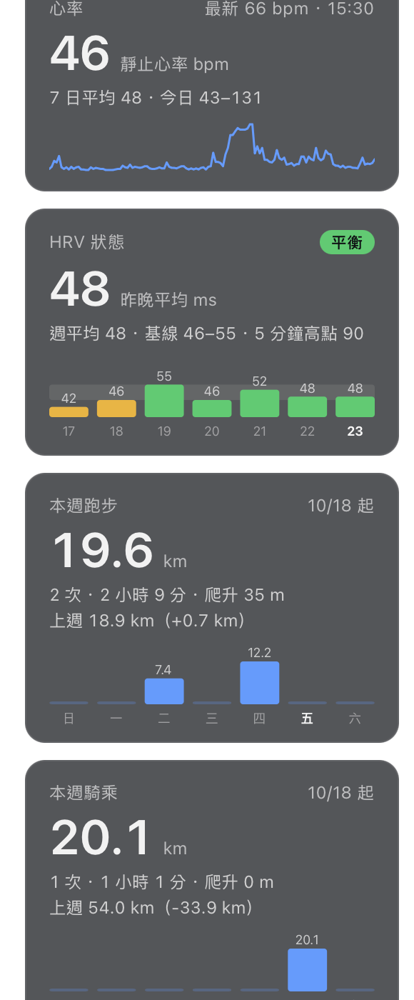

# garmin-ubersicht-widget

Mac 桌面上的 Garmin Connect 卡片。用 [Übersicht](https://tracesof.net/uebersicht/) 把四張卡片疊在桌布上、壓在所有視窗底下：**心率、HRV 狀態、本週跑步、本週騎乘**。資料走 Garmin 官方的 Personal API，不用爬網頁、不用存帳號密碼。

Garmin 官方沒有 Mac 小工具，iPhone 版 Garmin Connect 也沒有主畫面小工具，所以 macOS「iPhone 小工具接力」那條路走不通，才自己做一個。



## 卡片內容

| 卡片 | 顯示 |
|---|---|
| 心率 | 今日靜止心率、7 日平均、今日最低到最高、最新一筆讀值與時間、今日心率折線 |
| HRV 狀態 | 昨晚平均、狀態（平衡／不平衡／偏低／差）、週平均、基線區間、5 分鐘高點、七夜長條圖（灰帶＝基線區間，顏色＝當夜狀態） |
| 本週跑步 | 公里、次數、移動時間、爬升、上週比較、週日到週六每日長條 |
| 本週騎乘 | 同上，含室內自行車 |

每週起始日照 Garmin 帳號設定（這裡是星期日），要改在 `fetch.py` 的 `WEEK_START`。

## 需求

- macOS，[Übersicht](https://tracesof.net/uebersicht/)：`brew install --cask ubersicht`
- Garmin 官方的 [Personal API](https://developer.garmin.com/) 工具 `gc-personal`，裝在一個 venv 裡（預設路徑 `~/garmin-env/bin/gc-personal`）
- 在 Garmin Connect 產生一把 Personal API key，放在 gc-personal 的預設路徑。key 有效期 30 到 180 天或一年，到期重新產生即可。

## 安裝

```bash
git clone https://github.com/mansonliu/garmin-ubersicht-widget.git ~/git/garmin-ubersicht-widget
ln -s ~/git/garmin-ubersicht-widget/garmin.widget "$HOME/Library/Application Support/Übersicht/widgets/garmin.widget"
```

Übersicht 會自動載入。先手動跑一次確認抓得到資料：

```bash
~/garmin-env/bin/python3 ~/git/garmin-ubersicht-widget/garmin.widget/fetch.py | python3 -m json.tool
```

## 檔案

- `garmin.widget/index.jsx`：畫面。位置在最上面 `className` 的 `top` / `left`（目前對齊左側系統小工具的正下方，直列一排）；刷新間隔 `refreshFrequency`（預設 15 分鐘）。
- `garmin.widget/fetch.py`：呼叫 gc-personal 抓資料，輸出一份 JSON。gc-personal 路徑在檔頭 `GC`。
- `garmin.widget/cache.json`：上次成功的資料（不進 git）。某段抓失敗時沿用並在卡片標「（舊資料）」，整個失敗會在底部顯示錯誤。

## 踩雷

- Übersicht 剛裝好第一次啟動的程序可能卡住：選單列有圖示，但沒開本機伺服器、沒建桌面視窗，`quit app` 關不掉，`open -a` 只會喚醒它。判定：`lsof -nP -iTCP -sTCP:LISTEN | grep 41416` 沒東西。解法：kill 掉再 `open -a Übersicht`。
- 要確認畫面，不要「隱藏所有 app 再截圖」。列出 Übersicht 的視窗 id，用 `screencapture -x -o -l <id>` 單抓那個視窗。
- 多螢幕或換解析度時位置要重量：系統小工具左緣與底邊的座標，減掉 Übersicht 視窗自己的 y 起點（選單列高度）。

## 授權

MIT
